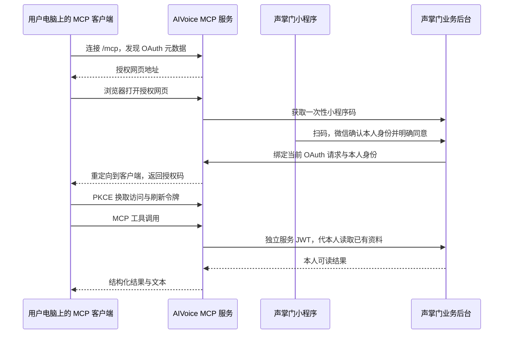

# 协议与业务适配契约

简体中文 | [English](architecture.en.md) · [项目首页](../README.md)

AIVoice 可以与其他应用共用服务器，也可以独立部署；MCP 客户端可以是支持相应协议的工具。

## OAuth 与状态

授权服务器 origin 为 AIVOICE_PUBLIC_ORIGIN；资源是该 origin + `/mcp`。标准元数据发现、授权码、PKCE、CIMD/DCR、刷新和撤销由 `oidc-provider` 实现。应用负责微信确认与业务权限，不自行实现 OAuth 密码协议。

浏览器交互由 provider cookie 绑定，确认 POST 另有 CSRF 随机值。二维码只含一次性 scene，不含业务用户 ID 或 token。小程序明确确认后，浏览器才能继续 OAuth 回调，令牌只交给已绑定客户端。二维码和交互 10 分钟过期；OAuth 授权码 60 秒、访问令牌 15 分钟、刷新授权最长 30 天。过期后由客户端发起重新授权。

请求不接受助手选择用户身份。每次访问重新向业务后台检查当前账号有效状态，并按本人设备成果归属读取。0.3.0 不要求加入组织；为兼容既有授权存储，身份信封仍保留 organizationId/version 字段，新授权固定为 0/1，这两个值不再承担组织权限控制。

## 私有适配契约

开源服务调用 `AIVOICE_BACKEND_ORIGIN/api/v1/aivoice/internal`。成功使用 HTTP 2xx 并返回 `{data:...}`；读取端从 `data` 字段取得结果，不依赖外层 `code` 的具体数值。失败使用适当的 HTTP 状态码并返回 `{error,message}`。JSON 响应不含秘密。

| 路径 | 数据 |
| --- | --- |
| GET `/identity` | 当前 `{userId,organizationId,version,displayName}`；失效则拒绝 |
| POST `/qrcode` | 输入 `{scene}`，输出 `{image}`（小程序码 PNG/JPEG 的 base64） |
| GET `/meetings` | 日期/关键词/分页过滤后的本人设备会议列表 |
| GET `/meetings/:id/transcript` | 本人既有转写分段，不生成 |
| GET `/meetings/:id/report` | 本人已保存的 standard/industry 报告分段，不生成 |

入站服务 JWT：HS256，issuer `aivoice-mcp`、audience `aivoice-internal`、sub 为用户 ID，org/ver 为当前授权上下文，60 秒时效；仅二维码请求允许 sub 为 `service`。

反向调用 `/aivoice/bridge` 使用 issuer `aivoice-backend`、audience `aivoice-bridge`、sub 为用户 ID 的独立服务 JWT：查询/确认一次性请求、列出本人授权、撤销本人授权。桥接密钥由双方管理员配置，不暴露给 MCP 客户端。

声掌门私有适配自行处理账号、设备来源与现有数据库映射。开源仓库不含私有表结构、业务实现或生产配置。

参考：[MCP 授权](https://modelcontextprotocol.io/specification/2026-07-28/basic/authorization)、[官方 TypeScript SDK](https://ts.sdk.modelcontextprotocol.io/v2/)。具体客户端支持情况见 clients.md，不以服务端合规推定所有工具均兼容。
